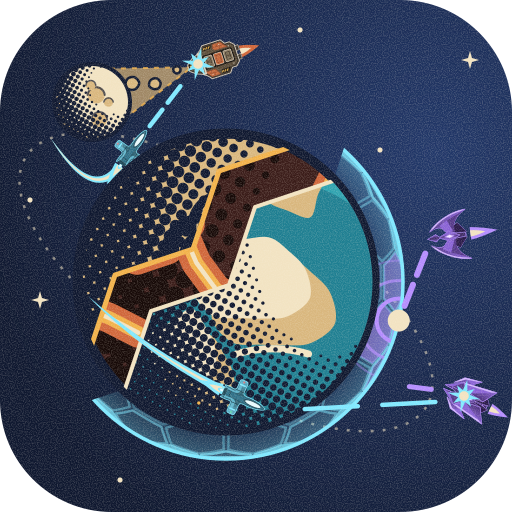

# GRAVOLVE

**Start as a rock. End as a star.**

### [▶ Play in your browser](https://hamzayslmn.github.io/GRAVOLVE/)

You are a tiny asteroid. Eat what is smaller than you, run from what is bigger, and grow:
into a planet, a living world with a shielded civilization, and finally a star.

## How to play

1. **Asteroid.** Touch smaller rocks to eat them. Bigger ones eat you.
2. **Planet.** Cool down, catch moons, gather water and air until life appears.
3. **Civilization.** Your ships mine, fight pirates and rival worlds; your shield takes the hits.
4. **Star.** Take over a star, build a Dyson sphere, settle new worlds.

There is no drag in space: you keep drifting, so push against your motion to brake.

## Controls

| | Keyboard and mouse | Touch |
|---|---|---|
| Move | WASD or arrows | drag |
| Select a moon | right click or E | long press |
| Grind a moon | hold right click or E | hold |
| Fire (civilization on) | left click, or Space | tap |
| Order an attack (civilization on) | right click or E on a body | long press |
| Zoom | mouse wheel | two-finger pinch |
| Play again | Enter, or R for a new run | button |

## License

[AGPL-3.0](LICENSE) © HamzaYslmn · developer notes in [`docs/`](docs/README.md)
